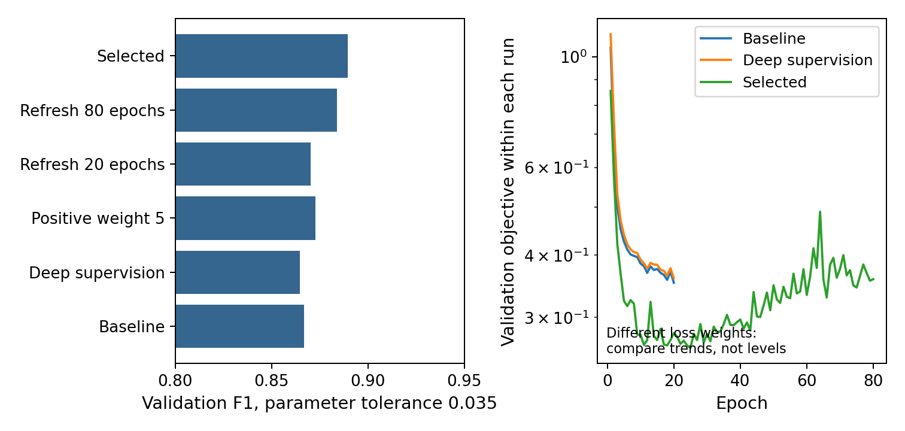
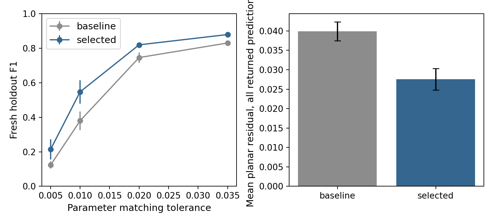
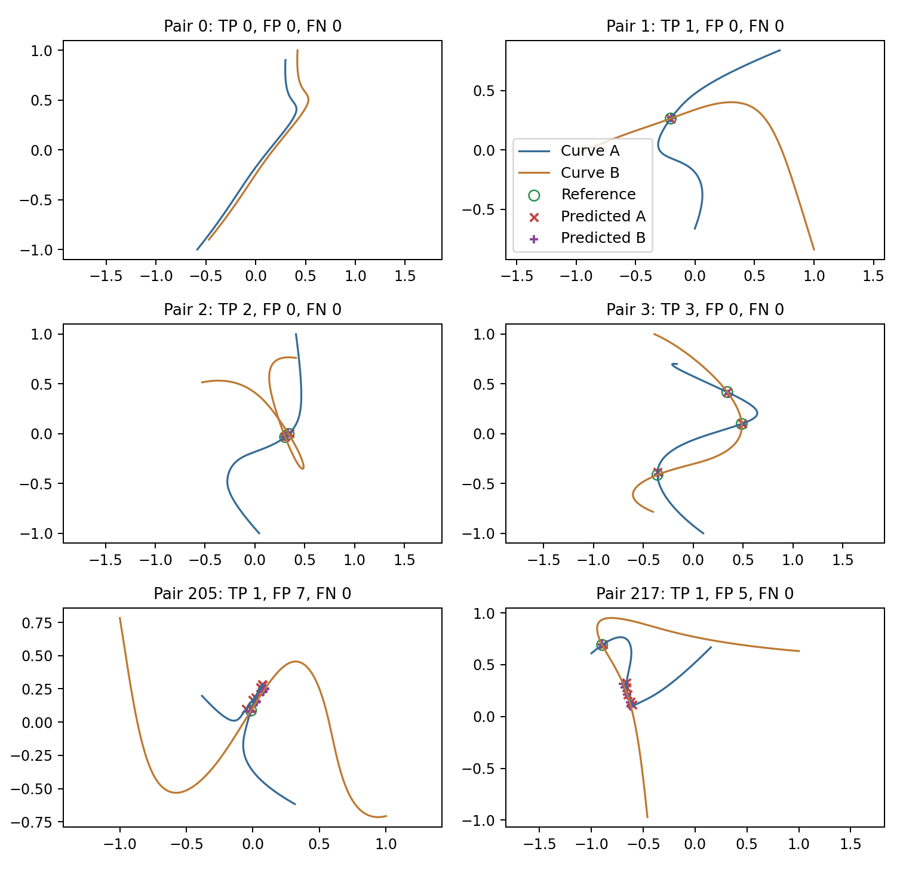

# 二维NURBS学习参数修正报告

实验日期：2026年10月26日。本文数字读取本轮保存的配置、权重和评测文件，不把历史评测修复计为模型进步。

## 一、研究目标与本轮结论

本轮以共享多层感知机（MLP）学习交点参数的修正量。每步由网络预测移动方向和距离，训练时通过曲线计算反向传播。推理不调用Newton，也不按最终几何残差阈值筛除输出。单种子验证F1从 0.8669 提高到 0.8894，增加 2.25 个百分点。两者均采用参数距离容差0.035和相同的一对一评测。

统一最终状态验证损失从 0.361894 变为 0.320841。该损失固定使用分类正例权重7、参数权重4、几何权重1；各实验自身的损失权重不同，不能直接比较各自最低损失。选择规则首先看验证F1，相同才比较统一损失，并不要求每轮两个指标同时改善。

锁定后新生成的400对留出曲线上，三种子平均F1由 0.8300 变为 0.8789，提高 4.89 个百分点。但将参数容差收紧到0.005时，改进模型平均F1仅 0.2139，还不能替代高精度数值求交。

当前数据仅含三次、8控制点、固定开放节点和全1权重的平面曲线，属于NURBS的B样条特例。候选仍由参数网格提出，所以目前是学习型参数修正方法，尚不能称为完全端到端的全部交点预测，也没有验证任意次数、控制点数和权重。

## 二、网络如何完成修正

先在48×48参数网格计算两条曲线的横坐标差、纵坐标差和点间距离，按局部低谷规则取8个候选。每个输入包括当前两个参数和周围5×5邻域的三通道残差，共77维。共享MLP有128、128、64三个隐藏层，输出两个修正量和存在分数，约34,947个参数。修正量经双曲正切函数限幅，更新后把参数截到0至1。

最终配置为 4 步修正，单步限幅 0.04，正例权重 5.0，参数权重 4.0，几何权重 1.0，深度监督 0.0，最多 80 轮，学习率 0.0005，批量256。每次保存自身验证损失最低的一轮，主种子保存第 25 轮。

动态邻域在每次移动后重新计算局部残差块，使网络看到当前位置附近的几何，反向传播也包含该采样对参数的导数。曲线导数用于损失和特征的链式梯度，不用来构造Newton更新。几何残差让网络学到两条曲线上的预测点应当重合；参数标签约束它靠近指定根，避免仅凭两曲线靠近就算正确。

深度监督指对中间状态也计算参数和几何损失。系数0只监督末步；0.5时各步权重从0.5线性增加到1，未归一化，因此会改变损失尺度。有限差分检查表明，中间损失的梯度已经接通，但实验没有显示0.5稳定提高F1，最终保留系数0。最终接受只依据验证集选择的网络分数阈值，再用0.025参数半径去重。加权分类分数尚未独立校准，不能直接当真实概率；去重可能合并极近真交点。

## 三、数据和实现检查

主数据为训练1600对、验证400对、历史测试600对，按0至3个交点均衡分层，生成种子20261025。标签由折线交叉搜索后离线数值细化获得；这一步含Newton，但只用于造标签，不参与网络推理，也不能保证发现相切或极近的所有根。候选对真值覆盖率为训练97.42%、验证97.83%，候选阶段本身可能漏点。

历史600对测试在较早实验中被观察，虽然本轮没有用于调参，仍只作为描述性对照。锁定配置和分数阈值后，另生成新留出400对，种子98711351，使用121和241采样密度核对参考根并按固定规则拒收不一致样本。它与训练集无完全相同曲线对，但来自同类合成分布，不代表真实CAD或分布外泛化。

通过基函数、解析参数导数、端点单侧导数、前向缓存和候选向量化等价检查，以及8配置有限差分梯度检查，网络最大绝对梯度差 7.77e-10。60组随机集合配对与穷举答案一致。关闭Newton、线性求解、矩阵求逆及训练几何损失函数后，静态与动态代表样本推理不变。这是已运行的隔离检查，不是任意路径的形式证明。

旧配对评测可能少算容差内可匹配预测。修复后，同一历史基线权重、同一阈值的F1从0.82143变为0.86688，完全是评测修复。新结果统一采用maximum_cardinality_v2，先最大化容差内一对一命中数，再最小化平方参数误差。

## 四、单因素实验

已完成 18 个阶段，逐项审计确认每阶段相对父配置只改一个所标记参数，保留失败对照和权重。先比较深度监督0与0.5，再比较步数、步幅和正例权重；随后根据定位问题引入动态邻域，并在该分支延长训练。反复使用验证集可能过拟合验证集，因此最终另作多种子和新留出评估。

| 实验 | 验证F1 | 统一损失 | 保存轮次 |
| --- | --- | --- | --- |
| 无深度监督基线 | 0.8669 | 0.3619 | 20 |
| 深度监督0.5 | 0.8647 | 0.3619 | 20 |
| 正例权重5 | 0.8729 | 0.3654 | 20 |
| 动态邻域20轮 | 0.8702 | 0.3473 | 17 |
| 动态邻域80轮 | 0.8838 | 0.3402 | 59 |
| 动态80轮深度监督0.5 | 0.8632 | 0.3252 | 53 |
| 最终选定 | 0.8894 | 0.3208 | 25 |

完整结果在results/learned_study/single_factor_results.csv。上表展示路径中的代表结果；相隔多项修改的行不能当单因素因果对照。

## 五、学习修正的定位诊断

验证集正候选初始平均参数误差 0.019313，修正后 0.016063。这里统计所有被赋正标签候选，不限于正确命中预测。保持网络分数不变、把坐标恢复初始候选时，F1为 0.8825；学习修正后为 0.8894；收紧到0.01容差时F1为 0.6314。零修正是事后干预诊断，分数仍依赖完整修正过程，不是独立训练的另一模型。

## 六、多种子与锁定后的测试

| 方法 | 种子 | 验证F1 | 统一损失 |
| --- | --- | --- | --- |
| 基线 | 20261026 | 0.8669 | 0.3619 |
| 基线 | 7 | 0.8528 | 0.3639 |
| 基线 | 19 | 0.8585 | 0.3649 |
| 改进 | 20261026 | 0.8894 | 0.3208 |
| 改进 | 7 | 0.9016 | 0.3331 |
| 改进 | 19 | 0.9009 | 0.3084 |

固定训练种子20261026、7、19，各自只用验证集选择保存轮次和分数阈值。下表是相同测试数据上的三次训练均值与总体标准差，不衡量测试抽样不确定性，也不足以声称统计显著。锁定后没有按测试成绩再调参。

| 数据 | 方法 | F1均值±标准差 | 查准率 | 查全率 |
| --- | --- | --- | --- | --- |
| 历史600对 | 基线 | 0.8447 ± 0.0056 | 0.8097 | 0.8830 |
| 历史600对 | 改进 | 0.8844 ± 0.0026 | 0.8608 | 0.9093 |
| 新留出400对 | 基线 | 0.8300 ± 0.0081 | 0.7787 | 0.8889 |
| 新留出400对 | 改进 | 0.8789 ± 0.0076 | 0.8355 | 0.9272 |

| 新留出 | 容差0.005 | 容差0.01 | 容差0.02 | 容差0.035 |
| --- | --- | --- | --- | --- |
| 基线 | 0.1231 | 0.3796 | 0.7457 | 0.8300 |
| 改进 | 0.2139 | 0.5471 | 0.8194 | 0.8789 |

主容差0.035位于归一化参数空间，不能等同于高精度平面求交。为避免宽容差掩盖定位误差，同时报告严格容差和全部返回预测的平面残差，不只报告成功命中的误差。

| 方法 | 交点数准确率 | 无交点误报率 | 去重后重复率 | 毫秒/对 |
| --- | --- | --- | --- | --- |
| 基线 | 0.7150 | 0.0900 | 0.0000 | 6.39 |
| 改进 | 0.7667 | 0.0767 | 0.0000 | 8.48 |

推理时间为CPU逐曲线对前向计时，包含候选构造、特征与网络更新、分数接受及去重，不包含离线标注和评测配对。只有单次顺序计时及三种子平均，未与传统算法在同等精度下比较，不能据此宣称更快。去重后的重复率定义为参数保留三位小数后的重复比例，不是原始槽位重复率。

新留出集基线的匹配参数平均误差 0.011516，全部预测平均平面残差 0.039900，各次残差95%分位数均值 0.108757。同分数零修正F1均值 0.8352。

新留出集改进的匹配参数平均误差 0.009439，全部预测平均平面残差 0.027603，各次残差95%分位数均值 0.068186。同分数零修正F1均值 0.8760。

## 七、解析边界测试

构造210对解析根已知的曲线，单交点、三交点、参数间隔0.02与0.005的近根、真正的端点、二重根相切、近距离不相交七类各30对。先规定可解析求根的三次多项式，再转换成同规格样条并共同旋转；控制点转换中的线性求解只用于离线造数据。真值独立于原数值标注器，且只在配置锁定后评估。

| 类别 | 基线均值 | 改进均值 |
| --- | --- | --- |
| 近根0.005 | 0.0000 | 0.0270 |
| 近根0.02 | 0.0101 | 0.0700 |
| 端点 | 0.0000 | 0.0000 |
| 三个交点 | 0.0852 | 0.2116 |
| 近距离不相交 | 0.0222 | 0.0000 |
| 单交点 | 0.9279 | 0.9402 |
| 相切 | 0.0000 | 0.1233 |

有交点类别填写F1；近距离不相交填写无交点曲线对误报率，越低越好。相切处梯度可能很弱，极近交点可能被0.025去重半径合并，主数据也没有针对这些情况训练，不能据普通测试声称已解决边界问题。旧边界脚本的部分名义相切和端点没有相应解析保证，本轮未沿用其标签。

本轮改进方法在端点类别F1为 0.0000，相切为 0.1233，间隔0.005近根为 0.0270，解析三交点为 0.2116。这说明普通同分布留出成绩不能外推到这些曲线。当前只确认了测试现象；训练分布、候选覆盖、网络分数与去重各自造成多少失败，尚未分解验证。

## 八、曲线实例与复现

绿圈是参考交点，红叉和紫色加号分别是预测参数在两曲线上的点。两个预测点不重合，说明仍有几何残差。图仅展示锁定模型，不参与选择。

同机、同Python与NumPy、单BLAS线程、同随机种子独立重训后，权重数组最大绝对差 0，验证参数输出最大差 0；验证F1原始 0.889423、重复 0.889423。依据解压数组而非压缩文件字节哈希核对。跨平台浮点和耗时可能不同。

代码按geometry、data、models、experiments、evaluation分类。配置、权重、完整训练曲线、失败对照、验证输出、单因素审计、环境和源码快照均保留。操作见《学习修正实验_复现说明.md》，已有同名metrics结果会跳过，真正重训要用新输出目录。

## 九、未完成内容与下一步

当前为NumPy手写反向传播，借鉴NURBS-Diff把几何计算接入可微训练的思路，并非其PyTorch/CUDA模块复现。研究思路中的完整二维概率图、集合匹配训练和不确定度头未完成；评测一对一配对不等于训练实现了集合预测。非单位权重、变化节点、未见控制点数量及原文可靠算法的同精度对标也未完成，不能宣称优于原文。

下一阶段需在新训练和验证数据中加入解析难例，另预留新的未查看测试集。先要求0.01与0.005严格容差下的学习修正优于同分数零修正诊断，再检查可学习候选与去重机制，不能用本轮边界测试选择新参数。旧高F1几何细化方案使用传统修正与残差筛选，保留为历史资料，不与本轮成绩混称。

本轮使用项目自己的受控脚本。已安装codex-autoresearch技能缺少官方控制器，未运行其提交回滚流程，没有自动Git提交或伪造官方事件。代码与报告由AI辅助生成和检查；研究者应亲自复现、理解方法并按学校要求说明辅助方式，不能称为全部独立手工编写。

## 参考文献

Prasad A D, Balu A, Shah H, et al. NURBS-Diff: A Differentiable Programming Module for NURBS. Computer-Aided Design, 2022, 146:103199. DOI: 10.1016/j.cad.2022.103199。书目信息核对本地论文；原文不直接给出本实验的求交修正网络。
